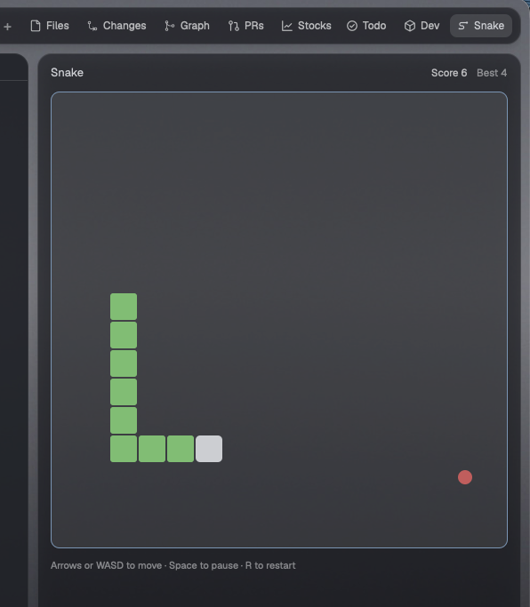

# Snake

Snake in a side panel of the [Herdr](https://herdr.dev) desktop app, for the minutes while
your agents work. Steer with the arrow keys or WASD, eat the dots, don't hit a wall or
yourself. A Snake button beside the tab bar opens it.



Version 0.1.0, built on herdr-app 0.1.16. What changed in each version is in
[CHANGELOG.md](CHANGELOG.md).

## Features

- **A 16×16 board** that fits the panel, growing and shrinking with it.
- **Keys**: arrows or WASD to move, Space to start or pause, R to restart, Esc to pause.
- **Gets faster** with every dot, and remembers your best score.
- **Pauses itself** when the panel hides or you click back into a terminal, so you never
  lose a game you weren't looking at.
- **Its own Snake button**, beside the tab bar's Files and Changes buttons.
- **Cheap to leave open**: no timer runs unless a game is running.

## Install

Ask your agent, from a terminal in Herdr:

```
Read ~/.config/herdr-app/AGENTS.md, then add this mod: https://github.com/noah4520/herdr-snake
```

It reads every file, copies the mod and puts its two blocks in your layout. Or do it
yourself:

```sh
git clone https://github.com/noah4520/herdr-snake.git
cd herdr-snake
./scripts/install.sh
```

Then add its two blocks to your layout.

### In a clone of Herdr's main layout

Herdr's own layouts are reset on start, so clone `main` first
(`herdr-app do layout.clone '{"name":"main","as":"my-layout"}'`). Add the board to the
`panel-body` stack:

```json
{ "id": "snake", "type": "block", "content": { "mod": "herdr-snake" } }
```

and put the `tabs` block in a 42px row with the button after it:

```json
{ "id": "tab-bar", "type": "row", "size": { "px": 42 }, "resizable": false, "children": [
  { "id": "tabs", "type": "block", "window_drag": true, "content": { "mod": "tabs" } },
  { "id": "snake-button", "type": "block", "size": { "px": 81 }, "window_drag": true,
    "content": { "mod": "herdr-snake", "props": { "button": true } } } ] }
```

### In Herdr Glass

[Herdr Glass](https://github.com/noah4520/herdr-glass) needs no restructuring: its tab bar
is already a row (`tabs`) holding the tab strip (`tab-strip`), with room left after it for
buttons like this one, and its tab bar mod makes space for them. Add the board block as
above, then add the button block to the `tabs` row, right after `tab-strip`. Use Glass's
rounder pill and leave out the divider line, which Glass's tab bar doesn't have:

```json
{ "id": "snake-button", "type": "block", "size": { "px": 79 }, "window_drag": true,
  "content": { "mod": "herdr-snake", "props": { "button": true, "radius": 8, "divider": false } } }
```

The button block's `size.px` is the pill's width, 71, plus the space after it: 10 at the
edge of Herdr's tab bar, 8 at Herdr Glass's, 3 when another button follows.

## Update and remove

To update, pull and install over the old files: `git pull && ./scripts/install.sh --force`.

To remove it, take the two blocks out of your layout and delete `mods/herdr-snake`.

## What it runs and stores

No programs, no network, no files. The best score is kept in the mod's own storage.

## License

[MIT](LICENSE).
