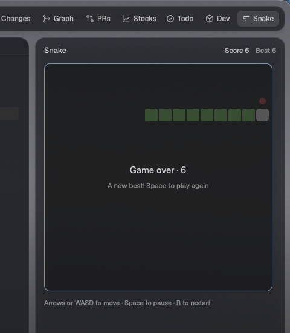

# Snake

Snake in a side panel of the Herdr window, for the minutes while your agents work: steer with
the arrow keys or WASD, eat the dots, don't hit a wall or yourself. A Snake button beside the
tab bar opens it, and the game pauses itself when the panel hides or the keyboard goes
elsewhere. Snake 0.1.0, built on herdr-app 0.1.16.

## What you see

Colours are theme names, so it follows the layout it sits in.

- **The Snake button**, after the tab bar's panel buttons: a 26px pill (8px side padding,
  5px gap) with a 14px snake icon and "Snake" in 12px. `selected` with `foreground` text
  while its panel shows, `chrome` with `muted` otherwise, `hover` on hover.
- **Header**, 42px, 14px side padding: "Snake" (13px semibold), "Score n" (11.5px `muted`)
  and "Best n" (11.5px `dim`).
- **Board**, 14px from the panel's sides: a 16×16 grid in a rounded box (radius 10, 1px
  border, `raised` fill), its border `accent` while the board has the keyboard and `border`
  otherwise. The grid sits 4px inside the border so no cell reaches a rounded corner. Cells
  are square and as large as the panel allows both ways (at least 10px).
  - The snake: body cells in `done`, 1px inset, radius 3; the head in `foreground`,
    radius 5. The dot: a `blocked` circle inset a quarter cell.
  - Over the board when not running, a `#0000008c` scrim with the inner radius: "Snake" /
    "Press Space or an arrow key to start"; "Paused" / "Press Space to go on" (or "Click
    here, then press Space" without the keyboard); "Game over · n" / "A new best! Space to
    play again" or "Space to play again" (15px semibold over 11.5px `dim`).
- **Hint line** under the board, 11px `dim`: "Arrows or WASD to move · Space to pause · R to
  restart".

## How it behaves

- **Start**: Space, Enter or an arrow key. The snake starts as three cells heading right.
- **Steering**: arrows or WASD. Up to two turns queue between steps; a turn straight back
  into the snake or the same direction again is ignored.
- **Steps**: every 150ms, 4ms faster per dot eaten, never under 60ms. The step timer runs
  only while a game runs and is replaced when the pace changes.
- **Eating** a dot adds a cell and a point; a new dot appears on a free cell. Hitting a wall
  or the body ends the game (moving onto the cell the tail is leaving is allowed). A full
  board ends it too.
- **Pause**: Space or Esc; R restarts at once. The game pauses itself when the panel is
  hidden or the board loses the keyboard. Showing the panel gives the board the keyboard;
  a click on it does too.
- **Best score**: kept in the mod's localStorage (`best`).
- **The button** shows the panel on the board's block, or hides the panel when it already
  shows it. The first click adds the block's id to shared `workspace.panels`, which the tab
  bar needs to remember each space's panel.

## Built from

- **Mod** `mods/herdr-snake/`: `main.js`, `mod.json`
  (`{ "place": "none", "title": "Snake", "focusable": true }`) and `snake.svg` (drawn with
  `svg()` so it takes the text colour).
- **One mod, two blocks**: with `props: { button: true }` it draws the button; without, the
  board. The button finds the board in the layout's `panel-body` stack by its mod, so the
  board block's id is free. `props.radius` sets the pill's corner (6 by default);
  `props.divider: false` drops the 1px `border` line under the button, for a tab bar with
  none.
- **Placement**: in a clone of Herdr's `main`, the board is one more child of `panel-body`,
  and the `tabs` block goes into a 42px row with the button block (81px) after it. In Herdr
  Glass, the button block (79px, `radius: 8`, `divider: false`) goes after `tab-strip`.
- **herdr**: `layout`, `props`, `run` (`layout.select`, `layout.show`, `layout.hide`),
  `shared` / `setShared` (`workspace.panels`), `theme`, `checking`; `cx.focus_handle`,
  `cx.timer.every` / `after`, `on_key_down`, `on_size_change`, `localStorage`.
  No programs, no network, no files.

## Watch out

- The board must hold the keyboard to get keys: track a focus handle on the root and focus it
  on show and on a click. Check `is_focused()` each step and pause when it's lost, or the
  snake runs into a wall while the person types elsewhere.
- Keep the step timer off while not running (`Task.cancel()`); a timer left running redraws
  the window for nothing.
- Don't change state during render: the pause on hide goes through `cx.timer.after(0, …)`.
- `overflow_hidden()` doesn't clip children to rounded corners: give the scrim the inner
  radius and inset the grid, or square corners poke out of the border.
- A mod doesn't know its text width, so the layout sizes the button block: the pill is 71px.

## Done when

- `herdr-app check mods/herdr-snake` passes.
- The Snake button opens the panel with the board lit (`accent` border); arrows start a game.
- Eating a dot grows the snake and the score; a wall or the body ends the game, and a new
  best is kept after a restart of Herdr.
- Clicking into a terminal pauses the game; hiding the panel pauses it too.
- The board's corners stay rounded with nothing poking out.
